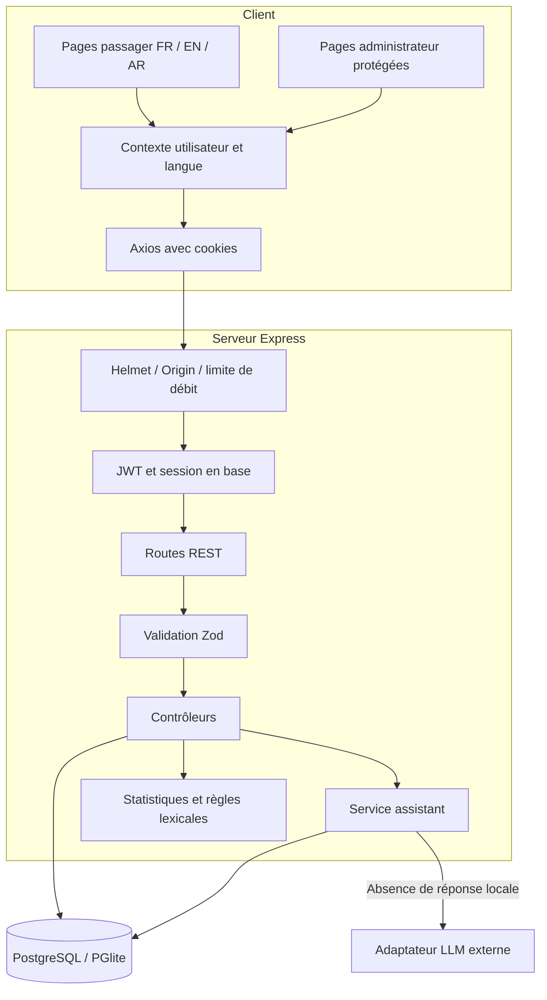
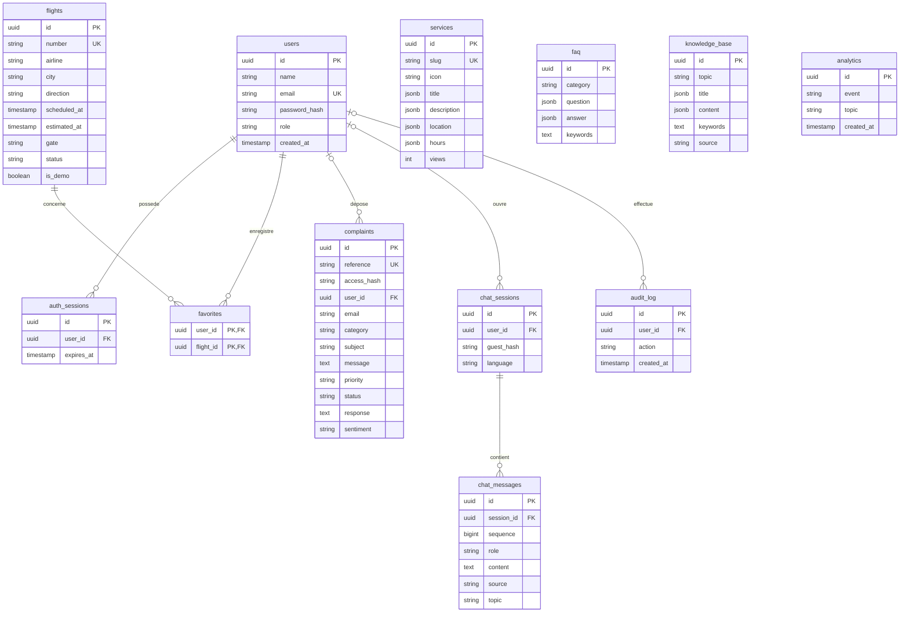
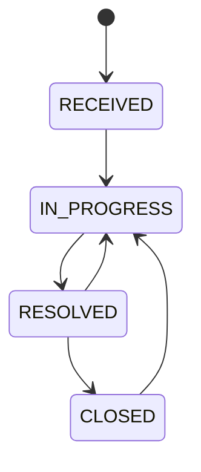
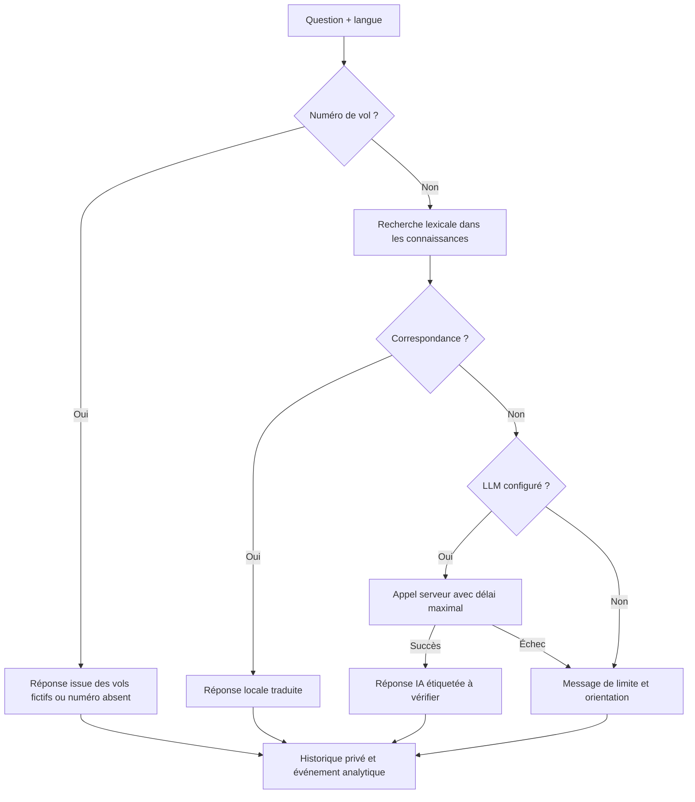

# Architecture et schéma relationnel

Les sources sont indépendantes des autres projets du workspace. Le nom public est **Oujda Smart**, sous-titre **Airport Assistant**. Le périmètre reste celui d’un prototype académique sans lien officiel avec l’ONDA.

## Architecture

Les scripts SQL utilisent des clés UUID, des contraintes de statut, des clés étrangères et des index. La couche `config/db.js` fournit `query`, `rows`, `one` et `tx`. Les contrôleurs ne dépendent pas du choix entre PostgreSQL serveur et PostgreSQL embarqué.

## Schéma de la base

`services`, `faq` et `knowledge_base` sont des ressources éditoriales autonomes. Le champ `topic` des événements est une dimension analytique, pas une clé étrangère : les événements de consultation utilisent un identifiant de service et ceux du chatbot utilisent un code thématique.

Les contenus JSONB ont la forme `{ "fr": "…", "en": "…", "ar": "…" }`. Les messages conservent la langue et le texte réellement utilisés. Le changement de langue de l’interface ne traduit pas rétroactivement l’historique.

## États d’une réclamation

La transition est contrôlée dans une transaction avec verrouillage de la ligne. Les modifications administratives sont journalisées. La réponse s’affiche dans le compte propriétaire et dans le suivi par code privé. Elle n’est pas envoyée par email.

## Flux du chatbot

## Suivi Flightradar24 optionnel

La route /tracking charge son propre module cartographique à la demande. Le navigateur appelle GET /api/tracking/flights. Express utilise un cache et un verrou de requête en mémoire par processus, puis le REST officiel FR24 avec une clé serveur. Les positions reçues ne sont pas insérées dans le catalogue PostgreSQL des vols fictifs. Les couches de carte OpenStreetMap sont chargées séparément par le navigateur, sans clé FR24. Voir FLIGHTRADAR24.md pour le cycle de vie et les limites multi-instance.

## Sources régionales gratuites — 8 octobre 2026

Le contrôleur appelle trackingProvider.js, qui sélectionne explicitement openSkyTracking.js, adsbTracking.js ou tracking.js (FR24). OpenSky est la source par défaut. Chaque adaptateur conserve une enveloppe identique et un cache avec regroupement des requêtes concurrentes. La base des vols fictifs reste séparée des positions réelles. L’interface distingue une zone géographique de routes liées à l’aéroport ; elle n’infère aucun itinéraire à partir des coordonnées. Voir FLIGHT-TRACKING.md.
